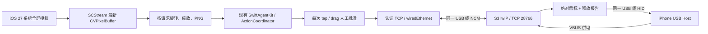

# iOS 27 ScreenCaptureKit + ESP32-S3 USB Device 实验分支

本分支实现并编译了新的采集与同线 NCM/HID 路径；尚未烧录或验证 iPhone USB 枚举、屏幕授权或实际控制。原 `firmware/` USB Host 工程保留，新的工程在 `firmware-device/`。没有增加设备、Wi-Fi/BLE 通道、Broadcast Upload Extension、VPN 或静音音频保活。

## 基线与隔离

- worktree：`/Users/developer/Developer/AI/ios-use/with-esp-usb-device-capture`
- branch：`feature/ios27-usb-device-capture`
- parent：`b3724382d5161555f0130fa984f72f251e7a07d8`
- 创建时主 worktree 有硬件文档/构建入口的未提交改动；原始状态保存在 [baseline.json](baseline.json)。未复制这些改动，未合并其他分支。
- 实施期间主 worktree 自行推进到 `45f0186`，Live Activities 自行推进到 `57acc61`；本分支仍以原 parent 为基线，没有重置它们。
- 原提交没有跟踪 `SecretStore.swift`，因为 `ios-app/.gitignore` 的 `secrets*` 在该环境误匹配。这里从已跟踪的 `archives/PhoneAgent-iOS-source.zip` 恢复相同源码到 `Storage/KeychainStorage.swift`；未读取用户钥匙串、增加 entitlement 或更改 service/account。

## 数据路径

图像只在 iPhone 内存，不传给 S3。用户在本次运行中明确开启“允许发送全屏截图到模型”后，现有视觉模型适配器才可发送截图；本次所有验证只使用合成帧/测试 provider，没有真实屏幕上传。模型网络仍使用原 HTTPS 设置和系统路由；仅设备 TCP 连接要求 `.wiredEthernet`，不会更改系统 VPN、默认路由或 DNS。

本实验分支最低版本为 iOS 27；主 Bundle ID 仍为 `com.ja1chen.PhoneAgent`。没有签名账户、App ID 注册或签名权限变更。

## 采集模块

`ScreenCaptureController` 调用 `SCContentSharingPicker.present()` 获取全屏授权，不调用仅采集自身的 `presentForCurrentApplication()`。只注册 `.screen` output，`capturesAudio=false`，picker 不显示麦克风/相机控制。Info.plist 只有新增的 `UIBackgroundModes=screen-capture`；没有音频、麦克风、照片权限。

本机 iPhoneOS 27 SDK 的 `minimumFrameInterval`、`pixelFormat`、`queueDepth`、`captureMicrophone` 都不可用于 iOS，本实现不设置这些属性。`videoOrientation` 按 SDK 的 `CGImagePropertyOrientation` 处理。

`LatestScreenFrame` 用锁保护一个原始 pixel buffer，没有逐帧 Task 或编码队列。截图时旋转为显示方向、最长边缩到 1280 px 并编码 PNG；元数据包括单调递增 sequence、单调时钟到达时间、源 PTS、墙钟时间、源尺寸、输出尺寸和原始 orientation。画面和序号不落盘；测试证据仅包含合成画面。

- 新 session 使用独立 epoch，旧 stream 迟到的数据/停止事件不能覆盖新 stream。
- complete 帧超过 2 秒未更新视为过期；blank/suspended/stopped 清空采集缓存。idle 不伪装成新帧。此策略偏保守，静态画面是否持续产生 complete 帧必须真机检查。
- 发送输入前重验缓存、批准帧 ID、5 秒批准帧期限、方向和尺寸；拒绝重入与范围外坐标。
- 收到动作 `executed` 后设置 sequence 和单调时间双重屏障；下一截图必须在 ACK 之后到达。不能用动作期间缓存的图证明执行结果。
- 采集可独立持续；**Agent 保留原来的离开前台就停止策略**，释放输入并撤销本次上传许可。这不是完整跨 App 后台 Agent 闭环。逐动作批准仍要回到 App。
- Xcode 27A266a 的 Simulator SDK 无 ScreenCaptureKit。模拟器明确禁用系统采集入口，仍可测缓存、编码、协议和现有 UI，不伪造全屏数据。

## USB Device / 网络

S3 使用原生 USB D− GPIO19 / D+ GPIO20，iPhone 是 Host 和 VBUS 电源；COM/CH340 串口桥不承载 NCM/HID。N16R8 只描述存储配置，不能确认板型或连接器布线。

固件初始化本地 lwIP Ethernet netif 与 TCP listener，固定 `192.168.7.1/24`，无默认网关。iPhone 初始验证手动设 `192.168.7.2/24`，路由器和 DNS 留空。没有 DHCP、NAT、转发、mDNS 或 Wi-Fi/BLE 初始化；实际 build graph 未链接 `esp_wifi`/`bt`。不采用虚假默认网关，也不启用新 VPN。固定 IP 验证成功后再设计发现流程。

NCM receive 回调复制以太帧到 lwIP pbuf，交给 TCP/IP 线程；TX 有界复制，等待 TinyUSB 消费后释放，超时返回网络错误。固件没有屏幕传输或文件服务。

| 构建 | 接口 | 端点（除 EP0） |
| --- | --- | --- |
| NCM-only | NCM control + data | 0x81 notification、0x82 bulk IN、0x02 bulk OUT |
| NCM+HID | 上述 + 一个 HID | 再加 0x83 interrupt IN |

没有调试 CDC。描述符声明 bus-powered 100 mA，无 remote wakeup；功耗尚未测量。HID report ID 1 为绝对鼠标（Agent 的 0…65535 坐标映射到 0…32767），ID 2 为键盘，只用于全释放，不暴露键盘输入工具。实验 VID/PID 沿用开发用途 Espressif VID，量产需取得适当分配。

HID 描述符可编译不等于 iOS 接受该指针映射或执行触控。AssistiveTouch 设置、点击/拖动坐标、横竖屏及系统版本差异都需要在无害测试画面上逐项确认。

## 认证、幂等和撤销

详见 [PROTOCOL.md](PROTOCOL.md)。密钥是既有独立 bridge PSK，App 存在已有钥匙串 account 中，S3 从 NVS `pa_usb/psk` 读取 32 字节 blob。未配置时返回 `PA1 LOCKED` 并关闭，无默认密钥，无自动生成/打印密钥，也不自动擦除 NVS。

设备每条 TCP 连接生成随机 challenge，认证和每条命令/ACK 都做 HMAC-SHA256；使用方向域与 session challenge 防止方向混淆和跨连接重放。TCP 不是加密通道，命令坐标可见，但密钥和截图不在 USB 通道传送。

命令 ID 在 session 内单调增加，固件保留 32 条幂等记录。相同 ID+参数返回已有阶段，不重做输入；同 ID 不同参数、过旧/被逐出的 ID 均关闭连接。收到请求只是 `received`；最终释放鼠标报告的 USB transfer completion 才产生 `executed`，仍不能证明 iPhone 的视觉效果。

App 每 200 ms 尝试一次 PING；动作过程中固件要求最近 750 ms 有认证 PING，动作总时限 2500 ms。TCP EOF、认证/格式错误、超时、USB detach/suspend/resume 代际变化均撤销会话、清空待执行动作并进入鼠标/键盘全释放状态。释放需 USB 总线和端点恢复就绪才能送达；断线时不能声称已物理释放，重新连接前必须先完成中性报告。未知结果从不自动重发。

`STOP` 撤销动作，待中性报告完成后 ACK 并终止 session；停止不会允许旧请求恢复。App 的新桥接仍通过现有 ActionCoordinator 逐动作授权及次数/时长限制，工具集保持 screenshot/tap/drag/wait/finish。

## 参考依据与已知边界

- [Apple iOS 屏幕采集](https://developer.apple.com/documentation/screencapturekit/capturing-screen-content-on-ios)、[同文 DocC](https://developer.apple.com/tutorials/data/documentation/screencapturekit/capturing-screen-content-on-ios.json)：API 和后台模式另与本机 SDK 核验。
- [Apple TN3179](https://developer.apple.com/documentation/technotes/tn3179-understanding-local-network-privacy)：在 App 前台由用户处理 Local Network 授权；拒绝或 waiting 后需要手动重新连接。
- [Espressif USB Device](https://docs.espressif.com/projects/esp-usb/en/latest/esp32s3/usb_device.html)、[官方 tusb_ncm 示例](https://github.com/espressif/esp-idf/tree/master/examples/peripherals/usb/device/tusb_ncm)：原示例是无线桥接，本实现改为本地网卡，不复制它的 Wi-Fi 初始化。
- [TinyUSB #3445](https://github.com/hathach/tinyusb/issues/3445)、[#3505](https://github.com/hathach/tinyusb/issues/3505)：iOS NCM 休眠恢复和 DHCP 报告是待真机回归的风险，不因固定新版本就宣称已修复。当前没有 DHCP。

没有下载或运行第三方商业控制器固件。官方说明和同类产品拓扑不能代替本板枚举/供电/控制实测。
